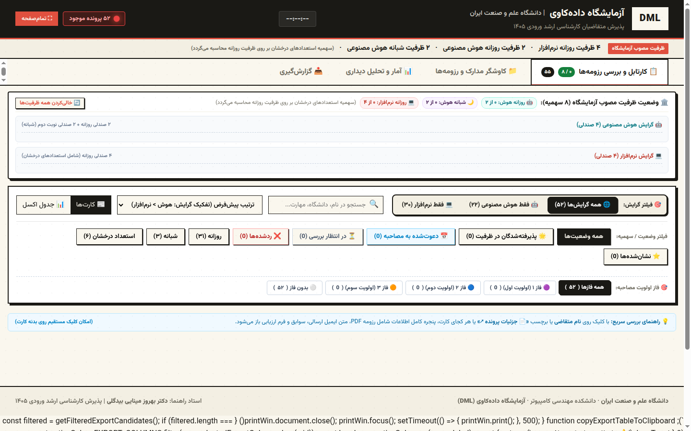

# 🎓 Academic Admission Studio
> **An open-source platform for faculty, research laboratories, and admission committees to review graduate applicants, simulate capacity allocations, schedule interviews, and automate academic correspondence.**

<div align="center">

[](#license)
[](https://www.python.org/)
[]()

**[English Guide](#english-guide) • [راهنمای فارسی](#persian-guide)**

</div>

---

<a name="english-guide"></a>
## 🖼️ Preview & Screenshots

### 1. Interactive Roster & Capacity Dashboard


### 2. Multi-dimensional Candidate Dossier & Live PDF Viewer


### 3. Seat Allocation & Laboratory Capacity Simulator


### 4. Shamsi Calendar & Interview Slot Scheduler


### 5. Automated Correspondence & Email Studio


### 6. Visual Merit Matrix & 2D Analytics


### 7. Export Studio & Excel Report Generator


---

## ✨ Key Features

- **Multi-dimensional Candidate Review:** Filter applicants by track, admission quota, evaluation status, and interview schedule. View PDF resumes and cover statements directly inside the browser.
- **Interactive Capacity Simulator:** Allocate candidates to laboratory quotas (Regular/Day, Evening/Night, Honors/Exceptional Talents) with real-time capacity progress indicators.
- **Persian (Jalali / Shamsi) Calendar Scheduler:** Configure 20-minute standard interview slots, custom dates, and location details.
- **Automated Communication Studio:** Generate tailored email drafts for invitations, acceptances, waitlists, and document requests with one-click Gmail and mailto integration.
- **Offline & Online Dual Mode:** Run entirely offline via `offline_dashboard.html` without requiring Python, or host with the Flask backend for live multi-device synchronization.
- **Privacy-First Architecture:** Shipped with 6 synthetic mock profiles. No private or real applicant records are contained in this repository.

---

## 🚀 Quick Start

### Option 1: Instant Offline Mode (No Installation Required)
Double-click `offline_dashboard.html` in any modern web browser (Chrome, Firefox, Safari, Edge).

### Option 2: Full Web Server (Linux / macOS)
```bash
chmod +x run.sh
./run.sh
```

### Option 3: Full Web Server (Windows)
Double-click `run.bat` or execute in Command Prompt:
```cmd
run.bat
```

### Option 4: Manual Python Run
```bash
pip install -r requirements.txt
python run.py
```
> The dashboard will start at `http://127.0.0.1:5050` and automatically open your default browser.

---

## ⚙️ Customization (`config.json`)

All titles, university branding, capacities, tracks, and email templates are customizable in `config.json`:

```json
{
  "institution": "Iran University of Science and Technology",
  "department": "School of Computer Engineering",
  "lab_name": "Data Mining Laboratory",
  "lab_short": "DML",
  "supervisor_name": "Prof. Behrouz Minaei-Bidgoli",
  "academic_year": "2026 - 2027",
  "port": 5050
}
```

After modifying `config.json`, recompile the static templates with:
```bash
python core/generate_seats_ui.py
```

---

## 📂 Managing Resumes & Applicants

Add resumes into the `resumes/` directory with the following structure:
```text
resumes/
├── <Track>/
│   └── <CandidateName>/
│       ├── CV.pdf
│       └── main.txt (optional: applicant cover letter)
```
Then discover and import them into the system:
```bash
python tools/import_candidates.py --scan-resumes
```

To export an Excel evaluation report:
```bash
python tools/export_report.py
```

---

<a name="persian-guide"></a>
## 🇮🇷 راهنمای فارسی (Persian Guide)

### 🌟 قابلیت‌های اصلی
1. **کارتابل پرونده متقاضیان:** دسته‌بندی و فیلتر بر اساس گرایش تحصیلی، سهمیه و وضعیت ارزیابی به همراه نمایش زنده رزومه PDF.
2. **شبیه‌ساز تخصیص ظرفیت:** مدیریت صندلی‌های روزانه، شبانه و استعداد درخشان با محاسبه لحظه‌ای ظرفیت تکمیل‌شده.
3. **تقویم شمسی زمان‌بندی مصاحبه:** تعیین وقت‌های ۲۰ دقیقه‌ای مصاحبه حضوری یا آنلاین.
4. **استودیو قالب‌ساز ایمیل:** صدور خودکار پیام‌های دعوت به مصاحبه، قبولی نهایی، رزرو و رد با یک کلیک.
5. **اجرای آفلاین و آنلاین:** امکان اجرا به صورت یک فایل مستقل بدون نیاز به سرور یا همراه با بک‌اند فلاسـک.
6. **امنیت داده:** مخزن مجهز به ۶ داوطلب فرضی و نمونه بوده و کاملاً فاقد داده واقعی دانشجویان است.

### 🏃 اجرای سریع
- **آفلاین:** باز کردن فایل `offline_dashboard.html` در مرورگر
- **لینوکس و مک:** اجرای `./run.sh`
- **ویندوز:** اجرای `run.bat`
- **پایتون:** `python run.py`

### 🔧 شخصی‌سازی
تمامی مشخصات دانشگاه، آزمایشگاه و قالب‌های ایمیل در فایل `config.json` قابل تغییر بوده و پس از ویرایش، با دستور `python core/generate_seats_ui.py` صفحات بازتولید می‌شوند.

---

## 📜 License
This project is open-source under the [MIT License](LICENSE).
